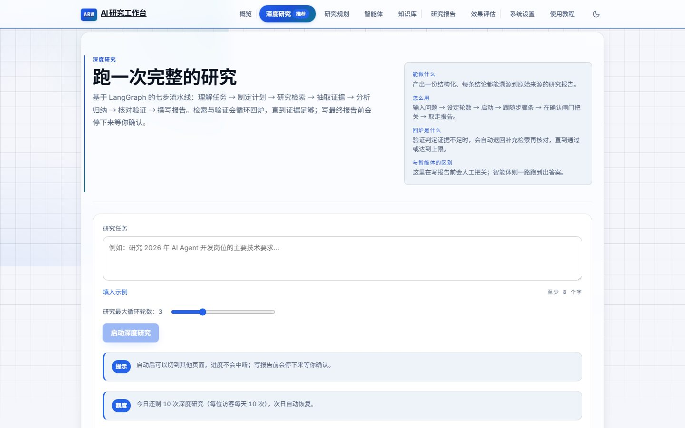
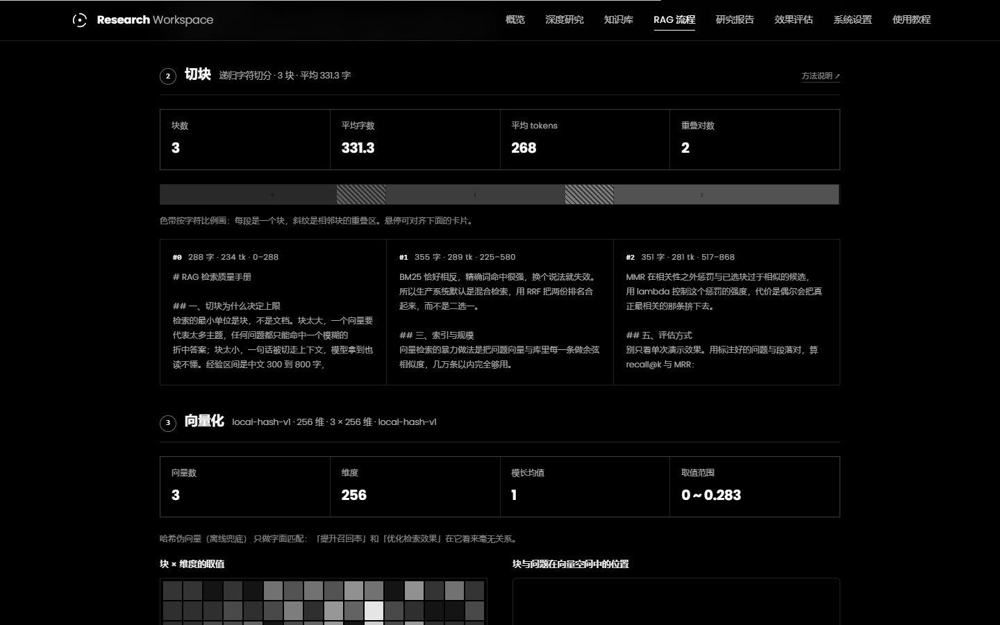

# AI Research Workspace 项目说明

本文说明项目定位、关键设计取舍与演进记录。README 侧重运行方式，本文侧重「项目是什么、为什么这样设计」。

**线上地址**：<https://2676136489-png.github.io/personal-design/demo/research.html>
（GitHub Pages 中转页，地址永久稳定——简历/作品集写这个；
它自动跳转到 WorkBuddy 托管实例，托管平台要求带分享码且码随发布变化）



---

## 一、这是什么

提交一个研究任务后，系统会拆解目标、制定计划、检索资料、分析并核查，但**在生成报告之前会暂停，等待人工确认**。

人工确认并非流程装饰，而是为了解决自动生成报告的可追溯性问题：读者需要知道结论是如何得出的。因此项目的核心并非生成速度，而是**每一步都可核查**：

- 每个步骤的输入输出都保留在时间线上，可以看到执行位置与 token 消耗
- 报告结论必须标注证据编号（`[证据1]`），证据来源（知识库文档 / 联网网页）直接写在证据条目中
- 正文未标注任何证据编号时，程序会将「未经证据核对」写入报告的局限说明，明确暴露问题而不是掩盖问题

前端 8 个页面：概览、深度研究、知识库、RAG 流程、研究报告、效果评估、系统设置、使用教程。

RAG 流程页将检索链路拆为五个阶段并分别展示：切块边界、2048 维向量热力图、块在可旋转三维向量空间中的分布、索引结构（归一化向量矩阵 + 倒排表 + 落盘文件）、每个候选的向量名次与 BM25 名次。配置区按四个横向区块组织，一个区块对应一个阶段：左侧为选项列表，右侧展示选中项的摘要、适用场景与官方文档链接：



---

## 二、技术栈

**后端**：FastAPI + LangGraph。研究工作流采用图结构（节点 + 条件边 + 中断点）而非线性链：一方面，「证据不足则重新检索」的回环用 if/else 表达可读性较差；另一方面，中断恢复需要保存完整 State。

**前端**：React 18 + Vite 5 + TypeScript，依赖只有 6 个（react / react-dom / motion / react-markdown / remark-gfm / three）。没有路由库（用 hash 自己解析）、没有状态管理库、没有 UI 组件库。

**模型**：统一调用层把 provider 抽象出来，换后端只改配置、业务代码零改动。
- 支持任意 OpenAI 兼容端点（线上用智谱 GLM-4-Flash）与本地推理后端，另有离线档位供不联网场景使用
- 带自动兜底：主后端不可用时按配置切换，并给对方一段冷却期，避免每次调用都空等一次超时
- 联网搜索走 Tavily，带配额记账（按 credit 计），超限时降级出报告但会明说

**规模**：后端 80 个 py 文件 / 约 1.38 万行，前端 59 个 ts(x) 文件 / 约 9100 行，后端 268 个测试。

---

## 三、研究流程

```
START
  ↓
understand_task   拆解研究目标与关键问题
  ↓
plan              生成研究计划
  ↓
research  ←───────────────┐  条件边：证据不足 → 再来一轮（≤ max_iterations）
  ↓                       │
retrieve           按子问题逐个检索（知识库优先，未命中回退联网）
  ↓
analyze            从证据提炼结论 + 标注缺口
  ↓
verify   ─────────────────┘  条件边：verdict=needs_more → 回炉（≤ max_verify_attempts）
  ↓
[中断]             interrupt_before=["write"]，等你点确认
  ↓
write              生成最终报告
  ↓
END
```

图的执行放在后台任务里，接口立刻返回 `running`。同步等整条流水线（2～5 分钟）必然撞上网关约 60 秒的超时，用户只会看到一个 504。

---

## 四、几个花了力气才做对的地方

**1. 网关会缓冲 SSE，所以实时的东西必须有轮询兜底**

进度条初始不会自动更新，需要手动刷新。排查发现，部署环境的反向代理缓存了整条 `text/event-stream` 响应：连接可以建立，但响应头不下发，浏览器的事件连接始终停在 CONNECTING，`onopen`/`onerror` 都不触发。

做法：后端补一个普通 JSON 的事件拉取接口（按事件 id 增量取，不会被任何网关缓冲），前端加看门狗，6 秒没打开就关掉那条连接改用 2.5 秒轮询；同时运行期间每 3 秒回拉一次运行快照，让步骤条、轮次、token 自己往前走。本地直连时仍然走 SSE。

**2. 知识库检索的可靠性，得先证明它可信**

知识库中存在示例文档时，任何问题都可能检索出若干「主题相近」的片段，相关度约为 0.3；这些片段随后进入报告引用，与研究内容并不相关。

最初的做法是加相关度阈值，实测后发现这条路不成立：本地哈希向量没有语义能力，分数分布是这样的——

| 查询 | 最高分 | 实际相关性 |
|---|---|---|
| 向量数据库选型对比 | 0.587 | 相关 |
| RAG 检索增强实践 | 0.441 | 相关 |
| 深度学习模型部署与量化 | 0.473 | **完全无关** |

无关内容的分数比相关内容还高，说明绝对阈值在这里切不开。结论是把判据从「分数够不够高」换成「检索能力够不够格」：
**只有向量具备语义能力时，知识库才作为研究依据参与**，不满足时自动让位给联网检索，
并在时间线上写明原因（`知识库未参与：检索缺语义能力`），不让用户误以为是漏检。

现在向量后端接的是智谱 `embedding-3`（2048 维），语义相似度切得开了：真相关集中在 0.6+
（实测 top 命中 0.768），而「同类句式但主题对不上」的沾边片段落在 0.35~0.5（实测无关主题最高 0.464）。
据此给「片段能不能当研究依据」定了 0.65 的门槛——低于门槛的片段不进引用，
模型会收到「知识库无相关内容，改走联网搜索」的明确信号，避免使用弱相关片段强行得出结论。
后端的发现链是「显式 `EMBEDDING_*` 配置 → 复用 LLM 端点与 Key → 本地 Ollama → 哈希兜底」，
每档都带 `semantic` 标记和降级原因，因此「本次检索是否具备语义能力」可以直接查证，无需推断。

向量还有个容易忽略的一致性问题：换模型之后，旧向量和新向量混在一个索引里，余弦相似度没有意义。
`documents.embedding_model` 记着每条向量是哪个模型算的，检索只认当前模型的；启动时的后台任务
`reindex_stale()` 把对不上的文档按新模型重算。知识库页会显示「有几份待重建」，并给一个一键重建的入口。

**3. 状态不能靠「图跑到哪了」来推断**

用户批准生成报告后刷新页面，确认框又弹出来了，于是又点一次批准。根因是状态推导用了 `snapshot.next` 非空当作「等待确认」——但 LangGraph 执行中途 `next` 也是非空的，于是研究跑着跑着被查状态也会变成 `awaiting_approval`。

现在只有真正停在写报告前（`next == ("write",)`）才算等待确认，批准时另写一个显式标记 `approval_granted`。状态机靠业务标记推导，不靠图内部位置。

**4. 测试数据写入生产数据库，并被部署流程一并上传**

历史记录中出现数百条相同问题。排查发现：测试只 mock 了模型和搜索，**从未隔离 SQLite 路径**，每执行一次测试都会向真实数据库写入数十条运行记录；部署工具又会打包上传整个 `backend/` 目录，导致本地测试数据进入线上。942 条记录中有 923 条由测试写入。

现在测试会话的四个库路径全部指向一次性临时目录，并且有一条测试专门守着这件事。

**5. 一个 CSS 动画属性让弹窗失去了居中能力**

报告弹窗没居中、顶部被导航栏盖住。弹窗明明是 `position: fixed; inset: 0` + `place-items: center`，读代码看不出任何问题。

用 DevTools 协议在真实页面里逐层扫祖先的计算样式，量出来是这样：

```
main.main → transform=matrix(1,0,0,1,0,0)   animation=page-in fill=both
```

页面转场动画写了 `animation-fill-mode: both`。`page-in` 只有起始关键帧，但 `both` 让动画结束后**继续保留动画算出来的 transform**——值是恒等矩阵，不是 `none`。而只要 transform 不是 `none`，这个元素就成了所有 `position: fixed` 后代的包含块，弹窗于是相对 `<main>` 定位（从导航栏下沿开始），而不是视口。

填充模式改成 `backwards`（视觉完全没变），弹窗同时用 portal 挂到 `body` 上，从结构上免疫。改完的实测：四个视口下遮罩都是 `0,0,视口宽,视口高`，居中偏差 ≤1px。

**6. 重叠参数得真能改变切块结果**

「重叠 80 字」这类参数最容易流于形式：界面上可以调整，但切出的块没有共享区，色带上也不会出现斜纹。按段落合并的切法中，单个段落通常有两三百字，大于重叠量，从尾部整段回退时无法回退任何内容。

改法是把重叠计进 `chunk_size` 预算：下一块从上一块尾部 `overlap` 字处起算，起点向前吸附到最近的句首，再往后装新内容直到装满。这样「块不超过设定大小」和「相邻块确实共享一段」同时成立，块的开头也不会落在句子中间。示例语料 868 字、400/80 的实测：切 3 块，2 处重叠各 63 字——比设定值小一点，因为要吸附到句号后。

另一个需要说明的副作用是：重叠计入预算后，每块可容纳的新内容减少，块数会略有增加（同一份 1309 字示例文档从 4 块变为 5 块）。这是以块数换取边界完整性，属于预期行为。

---

## 五、提交记录

按时间倒序。每条都写了当时的动机——这些取舍比代码本身更值得留着。

### 公开部署加固：权限边界、僵尸运行、报告深度与真实统计

这一轮针对「公开分享链接之后才会暴露」的问题，按优先级修了四类：

**1. 写操作有边界了。** 之前分享码只管「能不能打开页面」，拿到链接的人可以上传文档、
删除文档、清空全部历史。现在后端 `ADMIN_TOKEN` 留空即只读演示，删除 / 清空 / 上传 /
重建向量 / 调试端点一律 403；配置令牌后，前端在「系统设置 → 管理员权限」解锁，
请求头携带 `X-Admin-Token`，令牌只放当前标签页的 `sessionStorage`。

**2. 重启后的僵尸运行会被收敛。** checkpointer 是 `InMemorySaver`，进程重启后
「运行中 / 待确认」的记录已经无法恢复，但仍保留在数据库中，用户点击批准只会收到 409。
启动时统一标记为 `interrupted`，前端显示「已中断」并提示重新发起，不再诱导重复操作。

**3. 报告篇幅从「提示词要求」变成「代码硬检查」。** 之前 write 的提示词写着
「会被硬性检查」，实际只校验 JSON Schema；线上多份报告 472~934 字就交付。
现在 write 节点会逐项检查 summary ≥150 字、至少 3 节、每节 ≥200 字，不达标先带具体
缺口让模型扩写一次；仍不达标就写进 limitations，不再把「短报告」当「深度研究」交付。
verify 同时开始检查计划中的子问题是否都有结论，避免「所有结论都有依据，但有一半问题没回答」。

**4. 效果评估页补齐对外承诺的统计指标。** 列表接口改为轻量摘要，直接返回耗时、token、
失败原因；页面展示成功率、平均耗时、平均 token、状态分布与失败原因，不再只有四个计数。

同时将首屏 Poppins 改为自托管（`public/fonts`，六个字重共约 47KB），删掉 Google Fonts
外链——它是渲染阻塞资源，国内网络下会拖住首屏；CSP 也相应收紧了 `font-src` / `style-src`。
补了最小 CI（ruff + pytest + 前端构建），目前后端 268 个测试通过。

### 视觉重构：深空蓝控制台 → 纯黑 + 玻璃立方体首屏

上一版是冷调控制台：深空蓝底、电光蓝主色、发光与玻璃层。这一版把整套视觉推翻重做，只留黑白两色。

**为什么敢去掉颜色。** 这个产品里有五张数据图（切块色带、向量热力图、PCA 散点、检索打分条、七步进度）。只要主色还在，它就会和数据图抢注意力；把主色去掉之后，「颜色」这个维度只留给状态语义（完成 / 失败 / 警示），图形反而更容易读。层级改由字重（300–800）、字距与留白表达，不再靠卡片底色和阴影。

**首屏是实时渲染的玻璃。** 三行大标题并非 HTML 文本，而是先绘制到离屏 canvas，再作为纹理输入自定义着色器：

- 立方体按六个波段（R/Y/G/C/B/P）各自的折射率偏移采样坐标，16 次迭代后重建 RGB；蓝黄边并非叠加的渐变，而是不同折射率采样到不同位置的必然结果
- 两遍渲染：先把「背景 + 背面」渲进 `rtFront`，再拿它给正面当折射源；背面那遍采样纯背景 `rtBack`，所以能看见立方体后壁的内缘
- 模型已下载到 `frontend/public/models/glass.glb`，由站点同源加载，合并顶点后按最长边归一；加载失败或 8 秒未完成时回落到 `RoundedBoxGeometry`

**改版的主要成本在类名。** 旧样式分散在 7 个文件中（约 5.7k 行）。本次将样式收敛为两个文件：`world.css` 承载全站语法，`world-pages.css` 承载各页版面；组件结构与业务逻辑未做改动。主要风险并非「颜色未正确替换」，而是某些仅在错误态 / 展开态出现的类名未被新样式命中。为此增加了类名审计：将 TSX 中出现的 500 余个类名与 CSS 选择器做差集，当前差集为 0，并写入 `smoke-render` 的 46 条断言。

| 问题 | 根因 | 处理 |
|---|---|---|
| 标题整片消失，玻璃变成一块灰板 | 第三遍渲染立方体前没有关 `autoClear`，第二遍 `render` 把刚画好的背景连颜色一起清掉 | 屏幕这一遍先画背景，再 `autoClear=false` + `clearDepth()` 画玻璃 |
| 本地正常、线上模型无法加载 | 后端 CSP 为 `connect-src 'self'`，跨域加载 GLB 被拦截 | 当时精确放行模型域名；当前模型已本地化，CSP 恢复为 `connect-src 'self'` |
| 模型明明加载完成，状态却被改回 fallback | StrictMode 下 effect 跑两遍，被清理那一轮的 8 秒兜底计时器仍在跑，回来覆盖了状态 | 计时器随 effect 一起清理，且回调先判 `disposed` |

**验收**：`smoke-render` 46/46；RAG 深度探针在生产构建（由 FastAPI 同源托管）上全绿——真跑两种切法、检查色带重叠、热力图、散点、倒排表、命中打分条与知识库片段；1440 / 1024 / 390 三档截图无横向溢出。

**二轮修正（真实使用反馈）。**

- **流水线图按步骤播放**：从页面底部移动到状态条与「从这里开始」之间，并改为按步骤点亮（进入视口后每 430ms 推进一格，先绘制箭头再反白节点，七步完成后回到描边终态，回环弧单独标注）。同时修复一个 SVG 细节：`pathLength` 为 0 只能隐藏描边，末端箭头仍会单独绘制，表现为没有线的孤立箭头；未绘制时需同时将 `markerEnd` 置空。
- **导航改为宽屏平铺**：≥1181px 时 8 个页面全部平铺在顶栏，更窄时才收为 3 个主入口 + 全屏目录。判断依据为实测宽度：1200px 下 8 项加 logo 仍有余量。
- **线条与圆角**：结构线 alpha 从 .14 调整到 .22（行分隔 .08→.13，可交互描边 .3→.42），圆角从 2/6px 调整为 6/10px，输入框改为 1.5px 边框 + 浅底 + focus 外扩光晕。上一版在纯黑背景下难以分辨边界，这一版可以清晰区分卡片与网格。
- **「研究频繁失败」的根因并非模型**：计划连续两次生成失败后会进入兜底路径，而兜底使用「只有 1 个子问题」的任务理解直接构造 `ResearchPlan`，又被同一个 validator 拒绝，导致兜底路径自身抛出异常，整条 run 以 `ValidationError` 结束。修复分为两层：understand / plan 提示词明确要求「至少 4 条、最多 7 条」，兜底再按现状/对比/数据/原因/风险补齐维度并截断超长 goal，保证该路径不会抛出异常；同时补充 4 条回归测试覆盖该路径。

---

### 加载动画统一为三环旋转

先试过 Uplink 终端面板（见下一条），最终全站统一成三环旋转（Uiverse.io，MIT）：

- **色彩同源**：三环直接走 `--accent`，与全站电光蓝一脉相承；Uplink 的荧光绿是它自己的终端语境，放进本站等于引入第二套强调色
- **体量匹配时长**：局部加载大多几百毫秒到两秒，一块带进度叙事的面板反而喧宾夺主；56px 的三环刚好，模块级兜底配深空舞台 + 扫描线垫底
- **实现最省**：纯 border + transform（1s/2s/3s 异速旋转的「转速差」），无 rAF、无 iframe、无 JS 驱动；`prefers-reduced-motion` 降级为透明度呼吸

Uplink 方案暴露的两个问题（srcdoc 继承 CSP、外链字体阻塞 iframe 渲染）随 iframe 方案一并移除，`script-src` 恢复为 `'self'`。探索过程保留在 git 历史中（`5e03ecb`），需要终端风格时可整体恢复。

回归：RAG 页探针全部通过；smoke-render 与改动前一致（15 个失败为存量断言漂移，已通过 stash 对照确认）。同时修复探针拼接线上地址的方式——带分享码的 BASE 不能在 hash 前再插入 `/`，否则分享码变为 `XXX/`、网关返回 403、探针因白屏超时。

### 加载态整体换成 Uplink 终端面板

原加载态为低信息量的灰条骨架屏。整体替换为 Uplink Loader（ThreeUI Community，MIT）：模块级 Suspense 兜底使用完整版本（源码保留，经沙箱 iframe 渲染），站内 7 处局部加载使用同风格的紧凑终端面板——进度刻度条、百分比读数、阶段遥测文案、角标与扫描线，与全站「数据终端」的视觉语言一致。局部版本为纯 DOM + 单个 rAF（直接修改 DOM，不经过 setState），`prefers-reduced-motion` 下固定中间进度。

以下两个问题只有在真实浏览器中才能暴露：

| 问题 | 根因 | 处理 |
|---|---|---|
| iframe 一片黑，只剩底色 | `<head>` 里外链 Google Fonts 的 `<link>` 阻塞 iframe 首次渲染，受限网络下长时间挂起 | 去掉外链，回落系统等宽字体——主视觉靠字距/发光/布局，不依赖字体本体 |
| iframe 中刻度条始终无法绘制、读数停在初始值 | srcdoc 文档**继承父页 CSP**，`script-src 'self'` 不允许内联脚本，拦截过程无提示 | CSP 加入脚本内容的 SHA-256 哈希（比放开 `unsafe-inline` 收敛得多）；在 `backend/tests` 增加守卫测试，将 HTML 内容与 CSP 硬绑定，任一侧修改遗漏时测试直接失败 |

回归：RAG 页探针全部通过；smoke-render 178/193 与改动前完全一致（15 个失败为存量断言漂移，已通过 stash 对照确认与本次无关）。同时修复探针拼接线上地址的方式——带分享码的 BASE 不能在 hash 前再插入 `/`，否则分享码变为 `XXX/`、网关返回 403、探针因白屏超时。

### 视觉改版：暖调纸感 → 冷调深空蓝

原设计是暖调纸感（`#f2efe7` 纸底 + `#c0392b` 朱红 + 衬线字体），偏学术档案风。改成冷调：`#f4f6fb` 底 / 电光蓝 `#2563eb` 主色 / 青蓝 `#0e7490` 辅色，全站无衬线，叠渐变、发光与玻璃层。

**换色不只是审美问题。** 朱红 `#c0392b` 与 `danger` 同属红橙色系——主色和「危险 / 报错」在视觉上撞车，两者只有分开红色与蓝色才分得开。字体同理：衬线正是「学术档案」气质的来源，不换字体等于没改。

**只动了 3 个文件**：先统计了颜色分布，主题色全部在 `tokens.css`（158 处颜色值），业务 CSS 里只剩十来处渐变遮罩的技术性硬编码。改令牌 → 换一处全局生效，`pages.css` 与组件结构一行未改，回归风险最低。配色不靠肉眼定，每个前景/背景组合的对比度都先算再选值（浅底正文 ≥5.0:1，深底 ≥6.5:1，主按钮 5.17:1）。

三处问题只有真实浏览器能发现，因此补了两个 CDP 探针脚本（`probe-visual-theme.cjs` / `probe-visual-zoom.cjs`）把验证变成可断言的：

| 问题 | 根因 | 处理 |
|---|---|---|
| 激活态胶囊深底深字，1.23:1 | `.nav-link--active` 写在 `.nav-link` 之前，同为 (0,1,0) 优先级，后者 `color:var(--muted)` 盖掉白字 | 调换声明顺序，5.17:1 |
| 深色下渐变配白字最差 1.81:1 | 渐变末端恰好是文字所在那段，最易漏测 | 改亮渐变 + 近黑字，三档最差 6.44:1 |
| 换字体只改令牌，漏改 `index.html` 外链 | Inter 从未被下载，全站静默回退系统字体，还白拉两个用不到的字体阻塞首屏 | 两者同步改，并写入 `docs/production-readiness.md` |

探针不只查计算样式：theme 版查令牌、渐变、玻璃层与字体**是否真被下载**；zoom 版用 2x 像素密度 + 手写 PNG 解码做像素采样，确认氛围网格真的落到像素上（实测间距 62～64 设备像素，与 32px 栅格吻合），并断言 hover 态「文字 vs 自身背景」≥4.5:1。

### 线上环境重新发布

原先那个发布实例在托管侧被移除了，旧域名不再解析，于是以新实例重新发布 `backend/`。

- 当前线上入口：<https://2676136489-png.github.io/personal-design/demo/research.html>（GitHub Pages 中转，永久地址）→
  <https://ebed98754f5b4e4abafe591d754aff06.app.workbuddy.host/?sharecode=JJ4JF7TBGM>
  （平台网关要求带分享码，裸域名返回 403「链接不完整」；分享码随发布变化，变更时只改中转页一处）
- 发布参数：`language=python`、`installCmd=pip install -e backend`、`startCmd=python backend/start.py`
  （依赖在 `backend/pyproject.toml`；入口读 `PORT`、绑 `0.0.0.0`、单进程。这两个参数必须显式传，
  自动检测会误判为不存在的 `main.py`，导致线上启动失败）
- 单端口形态：FastAPI 同时提供前端产物与 `/api`，SPA 深链回退到 `index.html`
- 运行时数据在 `backend/` 之外（见 `cf26a69`），重新发布不会把本地库文件带上线，也不会覆盖线上已有的记录

README 与本文件里的旧地址同步做了替换——线上地址这种信息一旦过期，比没有更糟。

### 深度研究可用性 + 智能体历史 + 前端交互修复

聚焦于用户实际使用中的体验问题：

- **深度研究刷新丢状态**：批准后刷新会重新弹确认框、诱导重复批准；根因是状态推导用了「图内部位置」，改成显式业务标记（见上面第 3 条）。同时加了防重复批准（409）。
- **进度不自动走**：网关缓冲 SSE，加轮询降级 + 快照轮询（见上面第 1 条）。
- **引用内容与研究问题不相关**：知识库相关度门槛统一到唯一事实源，`research` 节点此前缺少该过滤；无语义嵌入时知识库不参与（见上面第 2 条）。
- **证据可溯源**：证据条目前缀从 `[知识库]` 改为包含命中的文档名 / 真实网页标题；报告正文要求实例紧跟证据编号，未标注任何编号时将「未经证据核对」写入局限说明。
- **效果评估的历史记录支持跳转**：此前仅为展示行。hash 增加可选目标参数（`#/reports?thread=xxx`），已完成的运行跳转研究报告，其余跳转深度研究（批准与失败原因查看均在该页）。
- **弹窗居中**（见上面第 5 条）、**教程页布局异常**（双栏 grid 依赖 DOM 顺序，目录与正文顺序相反；仅固定 `grid-column` 仍不足——`SectionNav` 在 DOM 中靠前，自动排布将其放入第 1 行右侧，正文被挤到第 2 行，导致正文上方与第 2 行右侧出现空白。两栏均显式声明 `grid-row: 1` 后才能并排）。
- **测试污染生产库**（见上面第 4 条）。
- 三处重复的 `formatTime` 收敛成一个公共函数。

### `db1bc2f` 修复线上配置全部静默失效

线上环境一直跑在开发配置上。两个独立缺陷叠加：`env_file` 用了相对路径，而部署环境的工作目录不是 `backend/`，所有 `.env` 配置项静默失效；多配置文件优先级在部署场景下互相污染（上传不按 `.gitignore` 过滤，开发配置也上了服务器，且优先级更高）。改成按运行环境只读一个配置文件。

### `906312e` `.env.production` 退出 Git 追踪

线上需要真实 Key，但 Key 不得进入仓库。同时增加了配置 Key 的工具，写入前强制校验目标文件处于 Git 忽略状态。已完成三层泄露扫描（暂存文件名 / 暂存内容 / 单文件内容）。

### `9fef775` 支持单端口部署

托管环境只暴露一个 HTTP 端口，没有第二个端口给 Vite dev server，所以后端必须同时提供前端页面和 `/api`。SPA 深链回退到 `index.html`，含目录穿越防护。

### `7b70f82` 初始提交

FastAPI + LangGraph 后端，React 前端，架构与 PRD 文档。

---

## 六、本地怎么跑

运行时数据默认落在项目根 `data/`（`backend/` 之外）——部署只上传后端代码，
线上数据不会被打包覆盖。

```bash
# 后端
cd backend
python -m venv .venv && .venv/Scripts/pip install -e ".[dev]"   # macOS/Linux 用 .venv/bin/pip
cp .env.example .env.local        # 按需填入模型与搜索的 API Key
.venv/Scripts/python -m uvicorn app.main:app --reload --port 8000

# 前端
cd frontend
npm install
npm run dev                       # 5173，通过 VITE_API_BASE_URL 指向后端
```

测试与检查：

```bash
cd backend
.venv/Scripts/python -m pytest tests -q      # 268 passed
.venv/Scripts/python -m ruff check app/ tests/
```

前端除了类型检查（`npx tsc --noEmit`）和构建校验，布局与交互类改动用 `frontend/scripts/` 下的 CDP 探针脚本在真实浏览器里量几何、断言跳转落地状态 —— 比截图目测靠谱得多。
