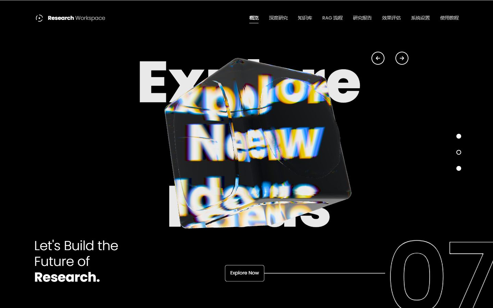
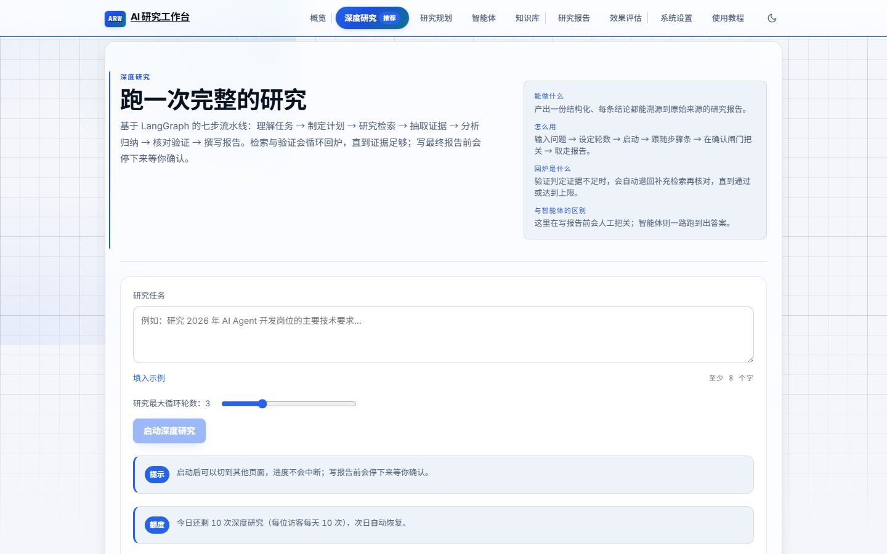
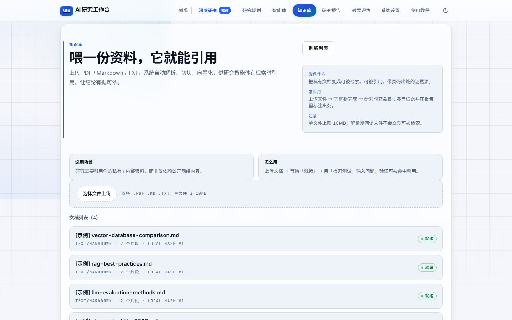
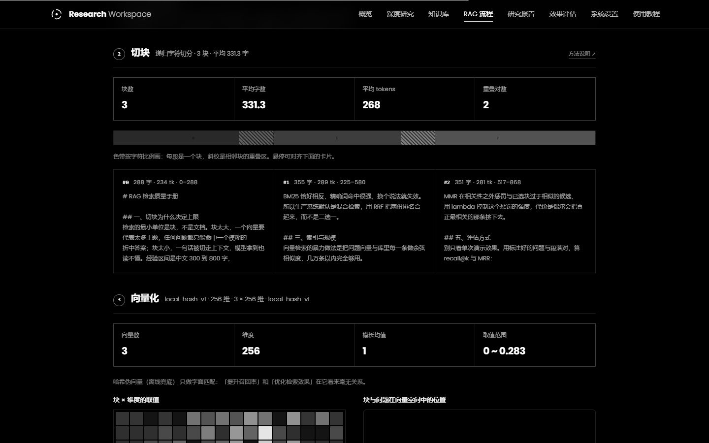
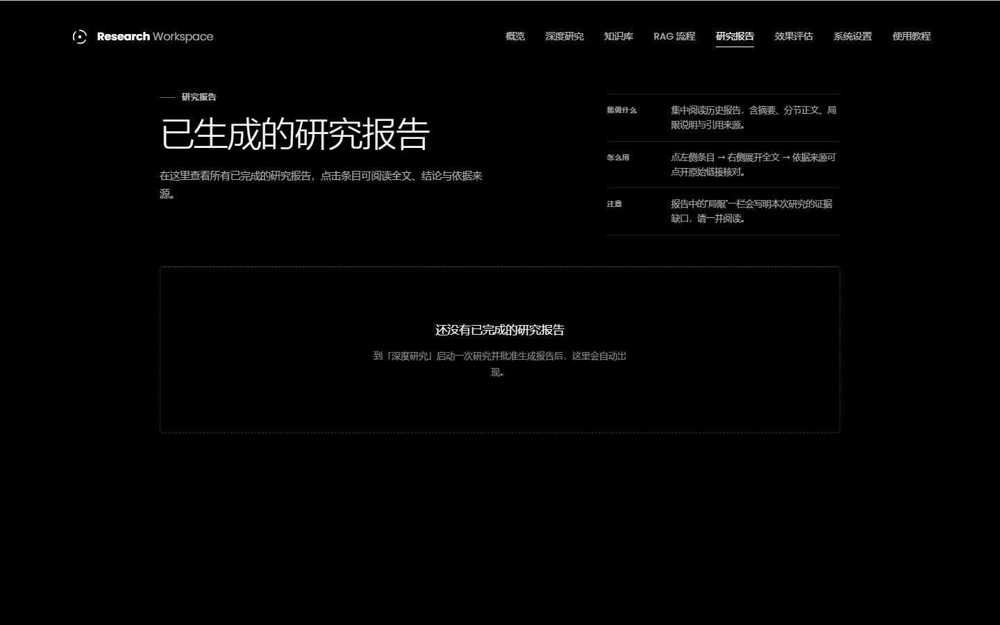

# AI Research Workspace

基于 LangGraph 的 AI 研究工作台，采用证据优先（evidence-first）设计。输入研究任务后，工作流依次完成任务理解、计划制定、工具调用（联网搜索 / 网页抓取 / 计算 / 知识库检索）、证据分析与验证，在生成报告前中断等待人工确认，输出带来源引用的研究报告。

**永久入口**：<https://2676136489-png.github.io/personal-design/demo/research.html>
（GitHub Pages 托管，自动跳转至在线系统）

**在线地址**：<https://ebed98754f5b4e4abafe591d754aff06.app.workbuddy.host/?sharecode=JJ4JF7TBGM>
（托管平台要求链接携带分享码；重新发布后分享码更新，以仓库最新文档为准）

在线实例无需配置环境：模型接入智谱 GLM-4-Flash，联网检索接入 Tavily。线上采用单端口托管，前端产物由 FastAPI 提供，`/` 为页面，`/api/*` 为接口。



8 个模块均可用（概览 / 深度研究 / 知识库 / RAG 流程 / 研究报告 / 效果评估 / 系统设置 / 使用教程），后端 268 项测试通过。架构与完整路线见 [`docs/01-architecture.md`](docs/01-architecture.md)，协作方式见 [`docs/00-collaboration.md`](docs/00-collaboration.md)，项目整体说明与关键设计取舍见 [`PROJECT.md`](PROJECT.md)。

## 项目背景

通用对话模型可以生成结构完整的报告，但结论缺乏来源，难以核对；研究过程不可见，无法判断结论是否建立在充分证据之上。将检索、分析、验证与写作拆分为可观测的流程节点，可使每一步的输入与产出均可追溯。

本工作台以证据链为核心：所有结论需引用检索到的材料，证据不足时自动补充检索，报告生成前强制人工确认。

## 目标用户与场景

| 角色 | 核心场景 |
| --- | --- |
| 研究人员 | 文献与公开资料调研，输出带来源的研究报告 |
| 产品与市场岗 | 竞品与行业信息收集，形成可核对的结论 |
| 学生 | 课题调研与资料整理，保留检索路径 |
| 开发者 | 复用工作流与工具链，扩展新的研究场景 |

## 问题定义

| 问题 | 现状 | 目标 |
| --- | --- | --- |
| 结论缺少来源 | 生成内容无法核对 | 每条结论引用具体证据，报告附带来源列表 |
| 证据不足仍输出结论 | 单轮生成易产生臆测 | 条件边回退补充检索，验证未通过时重新规划 |
| 过程不可观察 | 仅看到最终文本 | 节点级事件流，支持回放与断点续传 |
| 报告直接发布 | 缺少人工把关 | `write` 节点前强制中断，人工批准后生成 |
| 检索链路不可评估 | 参数与策略无对照 | RAG 实验台展示解析、切块、向量化、检索、组装五阶段明细 |

## 产品目标与指标

| 目标 | 指标 | 当前结果 |
| --- | --- | --- |
| 流程可运行 | 后端测试 | 268 项通过 |
| 状态可恢复 | 中断后批准 / 拒绝 / 跨进程查询 | 均支持，终态不可复活（409） |
| 过程可观察 | SSE 事件流与回放 | 支持 `seq 0` 回放与 `Last-Event-ID` 续传 |
| 界面可用 | 渲染冒烟与视觉探针 | 46 条结构断言、对比度 ≥ 4.5:1 |
| 资源可控 | 静态资源本地化检查 | 构建时校验，发现外部 CDN 即失败 |

## 功能范围

| 模块 | 能力 |
| --- | --- |
| 概览 | 运行统计、最近任务与系统状态 |
| 深度研究 | 启动工作流、人工批准或拒绝、事件流回放 |
| 知识库 | 文档上传、切块查看、语义检索 |
| RAG 流程 | 解析、切块、向量化、检索、组装五阶段明细与参数对照 |
| 研究报告 | 报告浏览、来源引用与局限说明 |
| 效果评估 | 运行质量与检索指标 |
| 系统设置 | 模型、预算、管理员令牌与用量 |
| 使用教程 | 操作指引与接口说明 |

---

## 1. 工作流图

```
START
  ↓
understand_task   拆解研究目标与关键问题
  ↓
plan              生成研究计划
  ↓
research  ←───────────────┐   ← 条件边：证据不足 → 再来一轮（≤ max_iterations）
  ↓                       │
retrieve           查自己的知识库补证据
  ↓
analyze            从证据提炼结论 + 缺口
  ↓
verify   ─────────────────┘   ← 条件边：verdict=needs_more → 回炉（≤ max_verify_attempts）
  ↓
[中断]  等待人工批准（interrupt_before=["write"]）
  ↓
write              生成最终报告
  ↓
END
```

每个节点：读 `ResearchState` → 返回一个**局部更新** → LangGraph 合并回 State。

---

## 2. 界面

| 深度研究 | 知识库 |
|---|---|
|  |  |

| RAG 流程 | 研究报告 |
|---|---|
|  |  |

首屏是一个用 three.js 实时渲染的玻璃立方体。背景那三行大标题不是 HTML 文字，而是先画进离屏 canvas、再作为纹理交给着色器采样——立方体按六段不同的折射率分别偏移采样坐标，透过去看到的文字就被放大、镜像，并拆出蓝黄边；倒角还靠菲涅尔反射勾出一圈白边。拖动可以旋转（松手带惯性），静置 0.6 秒后接回缓慢自转，左右箭头是 90° 吸附。

首屏之下是一张会「走一遍」的流水线图：滚到它进入视口后，从「理解」开始每 430ms 点亮下一个节点——先画出指向它的箭头，再反白当前节点，走完七步落回描边终态，顶部的虚线回环单独标注「循环补充证据」。

视觉语言只保留黑白两色：Poppins 300–800、1.5px 描边、6/10px 圆角、全站不用阴影。颜色只留给状态（完成 / 失败 / 警示），其余层级全部由字重、字距和留白表达。设计系统拆成两个文件：`styles/world.css` 放全站语法（排版 / 按钮 / 表单 / 卡片 / 状态 / 导航），`styles/world-pages.css` 放各页面版面，两者都不含业务逻辑。

> 首屏模型已下载到 `frontend/public/models/glass.glb`，由站点同源提供，不再依赖第三方地址；CSP 的 `connect-src` 只保留 `'self'`。加载失败或 8 秒未完成时回落到 `RoundedBoxGeometry`，首屏不会因此空掉。

---

## 3. 目录说明

```
backend/app/
├── graph/                  研究工作流（LangGraph）
│   ├── state.py            ResearchState：TypedDict + reducer（累加型字段）
│   ├── nodes/              7 个节点，每个只做一件事
│   ├── graph.py            装配：add_node / add_edge / add_conditional_edges / interrupt_before
│   ├── prompts.py          各节点 Prompt（与代码分离）
│   ├── schemas.py          节点之间的数据契约
│   ├── service.py          启动 / 恢复 / 查询（图在后台任务里跑，接口立即返回）
│   ├── run_store.py        agent_runs 表：产品视角的运行记录
│   ├── plan_store.py       研究计划历史
│   └── sources.py          工具输出 → 可展示的依据来源
├── agent/                  自主工具调用循环（选工具 → 执行 → 观察 → 作答）+ 运行历史
├── llm/                    统一模型调用层（多家 provider 可切换 + 自动兜底）
├── rag/                    解析 → 切块 → 向量 → 索引/存储 → 检索（实验台在 lab.py）
├── search/                 搜索配额记账与额度决策
├── events/                 事件总线 + 落库（可回放）
├── observability/          指标与追踪
├── tools/                  search_web / fetch_webpage / calculate / search_knowledge_base
└── tests/                  268 passed

frontend/src/
├── features/               8 个页面：概览 / 深度研究 / 知识库 / RAG 流程 / 研究报告 / 效果评估 / 系统设置 / 使用教程
├── components/             通用组件（步骤条、时间线、证据面板、Toast…）
├── api/                    唯一 HTTP 出口（SSE 与轮询共用同一条数据链路）
└── styles/                 设计令牌 + 分层样式
    ├── world.css           设计系统：令牌 + 排版 + 按钮/表单/卡片/状态 + 导航 + 首屏
    ├── world-pages.css     各页面版面（首页入口 / 知识库 / 设置 / 报告 / 教程 / RAG）
    ├── base.css            reset / 焦点环 / 页面转场
    ├── layout.css          壳层 / 容器 / 栅格
    ├── components.css      可复用组件
    ├── pages.css           页面级专属
    ├── responsive.css      响应式
    └── redesign.css        视觉层（氛围 / 组件重做，加载顺序最后）

frontend/scripts/            CDP 探针：布局 / 视觉 / 跳转 / 文档截图
docs/images/                 文档用首屏截图（由 docs-screenshots.cjs 生成）
```

---

## 4. 启动

```bash
# 后端
cd backend
python -m venv .venv && .venv/Scripts/pip install -e ".[dev]"    # macOS / Linux 用 .venv/bin/pip
cp .env.example .env.local        # 按需填入模型与搜索的 API Key
.venv/Scripts/python -m uvicorn app.main:app --reload --port 8000

# 前端（另开终端）
cd frontend
npm install
npm run dev                       # 127.0.0.1:5173
```

打开 `http://127.0.0.1:5173` → **深度研究**。

运行时数据（SQLite 与上传文件）默认写在项目根的 `data/`，刻意放在 `backend/` 之外：
部署只上传后端代码，不会覆盖线上正在使用的数据。

模型层是可插拔的：填一个 OpenAI 兼容端点的 Key 即可直接跑，也支持本地推理后端与离线档位。
切换只改 `.env` 里的 `LLM_PROVIDER`，业务代码零改动，详见 [`docs/llm-provider.md`](docs/llm-provider.md)。

### 4.1 写操作与管理员令牌

公开部署时，分享码只决定「能不能打开页面」，不决定「能不能改数据」。上传文档、
删除文档、清空历史、重建向量都需要管理员令牌：

- `ADMIN_TOKEN` 留空 → 实例为**只读演示**，所有写接口返回 403；
- 配置后 → 在「系统设置 → 管理员权限」输入同一个令牌解锁，请求头为 `X-Admin-Token`；
- 令牌只保存在当前标签页的 `sessionStorage`，不会写进 URL 或日志；
- `/api/debug/recent-errors` 同样要求管理员令牌。

这是公开演示的最小权限边界；如果需要多用户隔离，仍需接入正式账号体系。

### 4.2 静态资源与外部服务边界

**静态资源已全部本地化，运行时不再请求 CDN**：

- 字体：`frontend/public/fonts`（Poppins 300–800，含 OFL 授权）
- 首屏 3D 模型：`frontend/public/models/glass.glb`
- favicon、界面图标、文档截图：仓库内文件
- 前端构建产物：`backend/webapp`，由 FastAPI 同源托管

构建后执行 `npm run verify:assets` 可检查产物是否仍引用外部 CDN；CI 已接入该检查。

**运行时仍需调用以下外部服务；它们属于服务依赖，不属于静态资源**：

- LLM / Embedding：默认使用智谱 OpenAI 兼容端点
- 联网检索：默认使用 Tavily
- 研究过程中按需抓取的网页：由用户任务触发，属于产品能力

如需**完全离线运行**，可切换为以下配置：

```bash
LLM_PROVIDER=mock          # 或 ollama（本地模型）
EMBEDDING_PROVIDER=hash    # 本地哈希向量，仅字面匹配
SEARCH_PROVIDER=stub       # 内置离线语料，不联网
TAVILY_API_KEY=
```

npm 依赖通过 `package-lock.json` 锁定，Python 依赖通过 `uv.lock` / `pyproject.toml` 锁定。
上述依赖仅在构建与安装阶段使用，运行时不从外部拉取代码。

---

## 5. API

**深度研究（LangGraph 工作流）**

| 方法 | 路径 | 作用 |
|---|---|---|
| POST | `/api/graph/research` | 启动一次运行（会在 write 前中断，立即返回 `running`） |
| POST | `/api/graph/research/{thread_id}/resume` | 批准（`approved=true` + 可选 `feedback`）或拒绝 |
| GET | `/api/graph/research/{thread_id}` | 查询状态与结果快照 |
| GET | `/api/graph/research/{thread_id}/events` | 订阅事件流（SSE） |
| GET | `/api/graph/runs/{thread_id}/events` | 按事件 id 增量拉取（SSE 不可用时的轮询通道） |
| GET | `/api/graph/runs` | 历史运行列表 |
| DELETE | `/api/graph/runs/{thread_id}` · `/api/graph/runs` | 删除一条 / 清空 |

**智能体循环**

| 方法 | 路径 | 作用 |
|---|---|---|
| POST | `/api/agent/run` | 跑一次自主工具调用循环，返回答案 + 完整轨迹 |
| GET | `/api/agent/runs` · `/api/agent/runs/{id}` | 历史列表（摘要）/ 单条完整结果 |
| DELETE | `/api/agent/runs/{id}` | 删除一条历史 |

**研究计划 · 知识库 · 设置 · 模型**

| 方法 | 路径 | 作用 |
|---|---|---|
| POST | `/api/research/plan` | 生成结构化研究计划 |
| GET | `/api/research/plans` · DELETE `/{plan_id}` | 历史计划列表 / 删除 |
| POST | `/api/knowledge/documents` | 上传并摄入文档（PDF / Markdown / TXT） |
| GET | `/api/knowledge/documents` · `/{id}/chunks` | 文档列表 / 查看切块 |
| POST | `/api/knowledge/search` | 检索知识库 |
| GET | `/api/knowledge/status` | 当前向量后端 / 维度 / 是否具备语义能力 / 待重建文档数 |
| POST | `/api/knowledge/reindex?force=` | 按当前向量模型重建索引 |
| GET | `/api/llm/provider` · `/api/llm/ping` | 当前生效的模型配置（**不含密钥**）/ 实际调用一次模型 |
| POST | `/api/llm/stream` | 流式自测（逐块返回） |
| GET | `/api/settings` · `/api/settings/run-budget` · `/api/settings/usage` | 配置 / 当日预算 / 用量 |
| GET | `/api/admin/status` | 管理员令牌是否已配置、当前令牌是否有效（只返回布尔值）|
| GET | `/api/health` | 存活探针（带指标快照） |

> 删除运行、清空历史、上传 / 删除文档、重建向量与 `/api/debug/*` 需要请求头
> `X-Admin-Token`；后端未配置 `ADMIN_TOKEN` 时这些接口一律返回 403。
>
> `/api/agent/*` 与 `/api/research/plan` 属于后端能力接口，当前 8 个页面未提供独立入口，
> 保留用于脚本调用与二次集成；接口存在不代表页面已实现。

**RAG 实验台**

| 方法 | 路径 | 作用 |
|---|---|---|
| GET | `/api/rag/options` | 切块 / 检索 / 向量后端 / 参数元数据（前端控件的唯一数据源） |
| POST | `/api/rag/pipeline` | 解析 → 切块 → 向量化 → 检索 → 组装，返回五阶段明细与耗时 |

```bash
# 启动一次研究
curl -s -X POST http://127.0.0.1:8000/api/graph/research \
  -H "Content-Type: application/json" \
  -d '{"question":"研究 2026 年 AI Agent 开发岗位的技术要求","max_iterations":3}'
# → data.status = awaiting_approval，记下 data.thread_id

# 批准生成报告
curl -s -X POST http://127.0.0.1:8000/api/graph/research/<thread_id>/resume \
  -H "Content-Type: application/json" -d '{"approved":true,"feedback":"补充局限说明"}'
```

---

## 6. 质量验证

| # | 项 | 方法 | 期望 |
|---|---|---|---|
| 1 | 完整流程 | Workflow 页启动 | 流水线点亮到 verify，状态 `awaiting_approval` |
| 2 | 人工确认 | 填意见 → 批准 | 状态 `completed`，出现 Report（含 sections / limitations） |
| 3 | 拒绝 | 点「拒绝并终止」 | 状态 `cancelled`，无报告 |
| 4 | 循环 | 看 Pipeline | `Research ×N`（N ≤ max_iterations） |
| 5 | 单元测试 | `.venv/Scripts/python -m pytest tests` | `268 passed` |
| 6 | 静态检查 | `.venv/Scripts/python -m ruff check app tests` | `All checks passed!` |
| 7 | 前端类型 | `npm run typecheck` | 无输出 |
| 8 | 布局与跳转 | `frontend/scripts/` 下的 CDP 探针脚本 | 元素几何 / 跳转落地状态符合断言 |
| 9 | 渲染冒烟 | `node scripts/smoke-render.mjs` | 46 条结构与契约断言（含 three.js 渲染管线、类名覆盖率）|
| 10 | 视觉截图 | `node scripts/shoot-world.cjs <地址> dashboard,workflow` | 逐页截图落到 `.probe-world/`，用于人工比对版面 |
| 10 | 细节点与对比度 | `node scripts/probe-visual-zoom.cjs <地址> dark` | hover 态对比度 ≥4.5:1、网格落到像素 |
| 11 | RAG 实验台 | `node scripts/probe-rag-page.cjs <地址>` | 四条横区按序堆叠、每区「选项在左 / 详情在右」、详情含官方文档链接、回显正确、五张图齐、色带段数=块卡片数、斜纹重叠>0、倒排索引有词与块号且索引落盘出两个文件、无横向溢出 |
| 12 | 文档截图 | `node scripts/docs-screenshots.cjs <地址>` | `docs/images/` 下 6 张首屏图，页面已渲染完（非骨架屏） |

配色按 WCAG 2.1 取值，`world.css` 中文字与底色的组合均满足对比度要求（正文 ≥ 4.5:1，浅底 ≥ 5.0:1，深底 ≥ 6.5:1）。第 9、10 项用于验证样式实际生效：渐变被高优先级规则覆盖、字体声明未下载等问题无法通过计算样式发现，需在真实浏览器中检查。

**实测结果**：`understand_task → plan → research ×3 → retrieve → analyze → verify`（中断）→ 批准 → `completed` + 报告；重启进程后仍能查到 `completed` 与报告（来自 `agent_runs` 落库）。

---

## 7. 运行约束

| 闸 | 位置 | 作用 |
|---|---|---|
| `max_iterations` | 条件边 `route_after_research` | research 循环上限 |
| `max_verify_attempts` | 条件边 `route_after_verify` | 验证回炉上限 |
| `MAX_FAILURE_STREAK` | 条件边 | 连续工具失败 2 次就不再重试 |
| `recursion_limit=50` | invoke config | LangGraph 层面最后保险 |

---

## 8. 中断与恢复机制

- 中断点：`interrupt_before=["write"]` —— **报告发布前必须人工确认**
- 终态不可复活：`completed` / `cancelled` / `failed` 三种终态下再调 resume 返回 409
- 恢复范围：checkpointer 目前用 `InMemorySaver`，覆盖同一进程内的两次 HTTP 请求；
  运行结果与会话状态同时落库（`agent_runs` 表），跨进程照样能查询、能回放 ——
  落库时会把派生状态（如 `awaiting_approval`）一并写入，重启后读到的状态与中断时一致
- 需要跨进程恢复时切到 `langgraph-checkpoint-sqlite` 即可，业务代码不用改

---

## 9. 范围边界

以下范围为**明确排除**，不属于待办事项：

| 不做 | 原因 |
|---|---|
| Multi-Agent | 7 个节点共享同一份 State 与同一个 LLM client，属于单个 Agent 的不同阶段。拆分为多个 Agent 仅增加消息传递与状态同步，职责不变 |
| 复杂 Memory | 现有 `messages` 与 State 中的 evidence 列表已满足需求；向量记忆属于独立问题，与结论溯源无关 |
| 并行子问题检索 | 检索耗时占比较低，并行收益有限，同时需为 State 合并与部分子问题失败增加收敛判断 |
| 跨进程恢复 | 见 §8。切换至 SQLite checkpointer 属于配置级改动，待出现多实例需求后再引入 |

判断标准：新需求若不能增强证据可溯源、过程可观察、结论可复核三者之一，则不纳入当前版本。
架构取舍的完整推演在 [`docs/01-architecture.md`](docs/01-architecture.md)。
