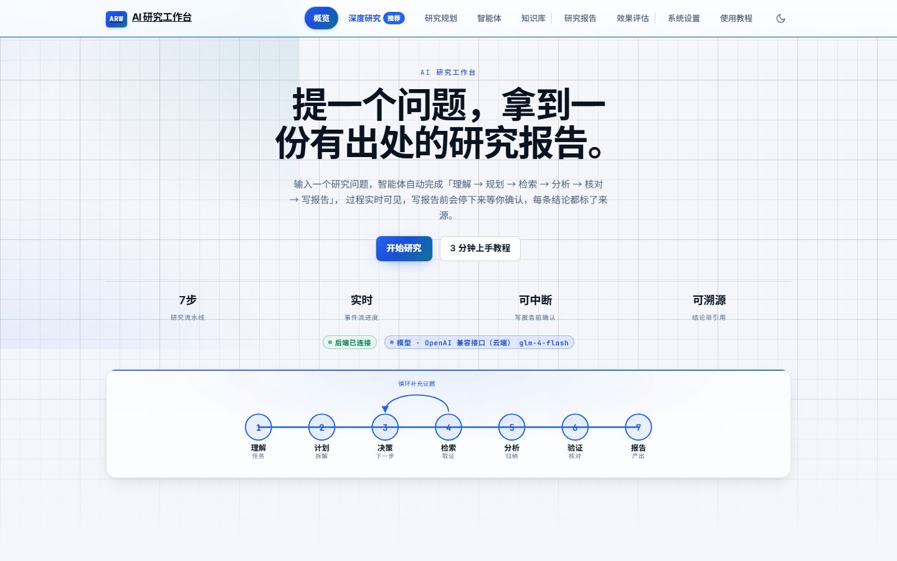
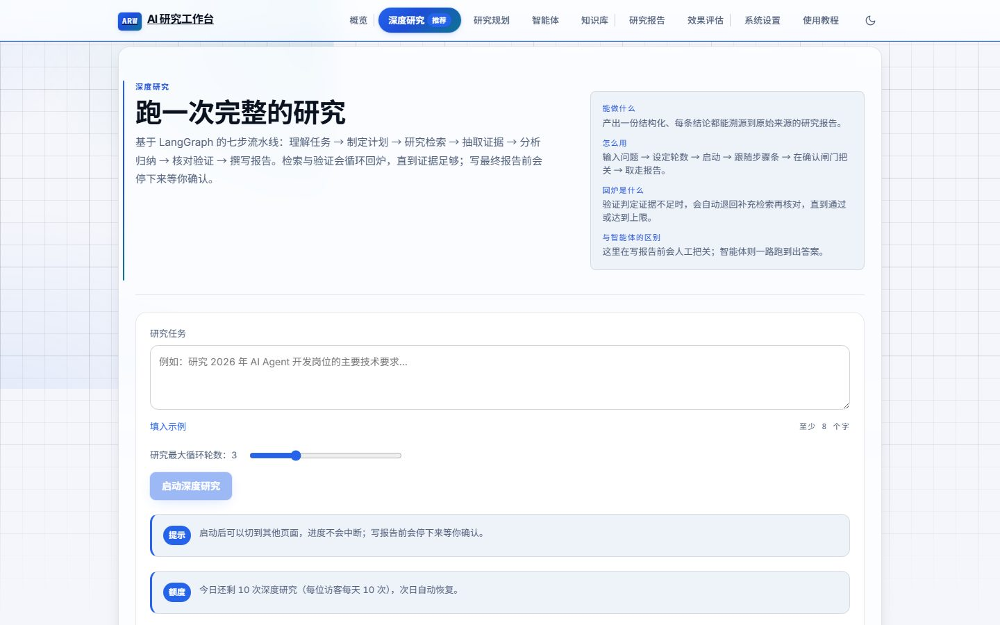
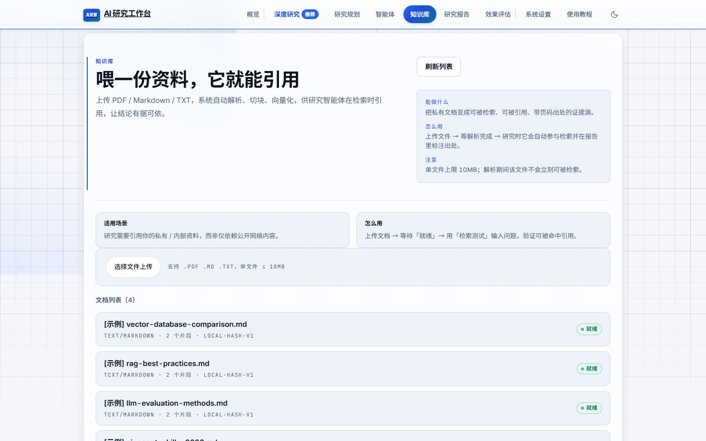
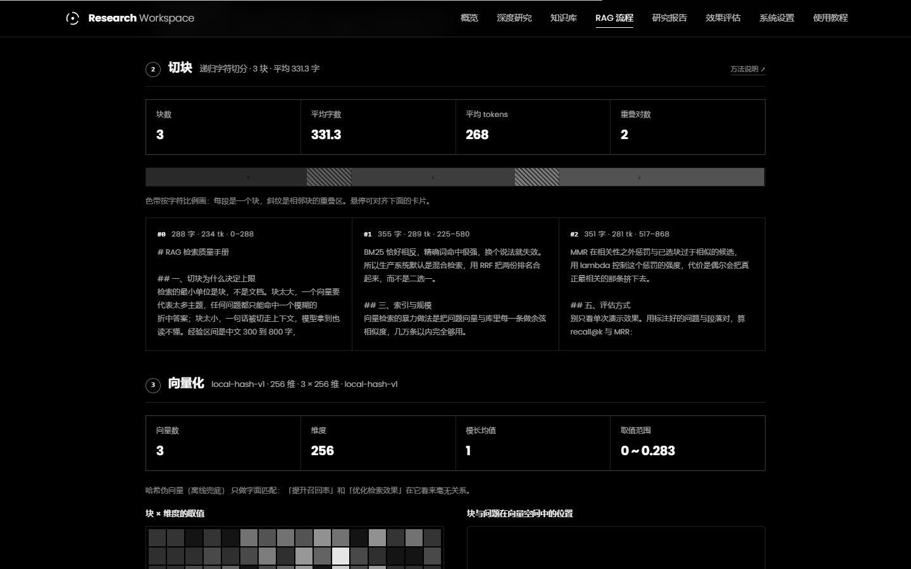
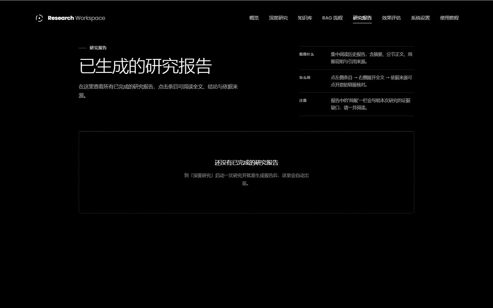
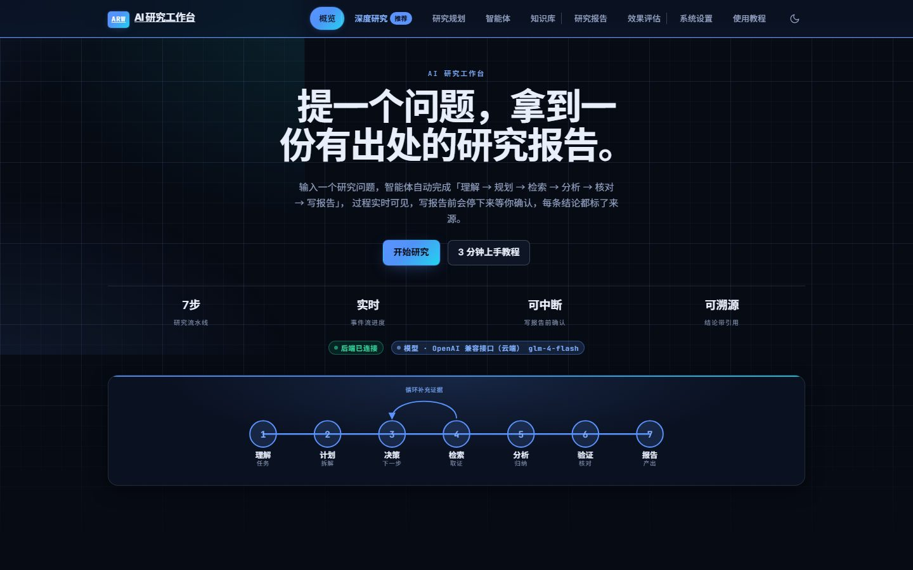

# AI Research Workspace

一个 **Evidence-first（证据优先）的 AI 研究工作台**。输入复杂研究任务，LangGraph 驱动的工作流自动理解任务、制定计划、调用工具（联网搜索 / 抓取网页 / 计算 / 查知识库）收集证据、分析、验证，在写报告前**中断等待人工确认**，产出带来源的研究报告。

**在线地址：<https://ebed98754f5b4e4abafe591d754aff06.app.workbuddy.host/>**

打开就能用，无需配置环境：模型接智谱 GLM-4-Flash，联网检索接 Tavily。线上是单端口托管——前端产物由 FastAPI 一起提供，`/` 是页面、`/api/*` 是接口。



8 个模块均可用（概览 / 深度研究 / 知识库 / RAG 流程 / 研究报告 / 效果评估 / 系统设置 / 使用教程），后端 256 个测试通过。架构与完整路线见 [`docs/01-architecture.md`](docs/01-architecture.md)，协作方式见 [`docs/00-collaboration.md`](docs/00-collaboration.md)，项目整体说明与关键设计取舍见 [`PROJECT.md`](PROJECT.md)。

---

## 1. 工作流图

```
START
  ↓
understand_task   拆解研究目标与关键问题
  ↓
plan              生成研究计划
  ↓
research  ←───────────────┐   ← 条件边：证据不足 → 再来一轮（≤ max_iterations）
  ↓                       │
retrieve           查自己的知识库补证据
  ↓
analyze            从证据提炼结论 + 缺口
  ↓
verify   ─────────────────┘   ← 条件边：verdict=needs_more → 回炉（≤ max_verify_attempts）
  ↓
[中断]  等待人工批准（interrupt_before=["write"]）
  ↓
write              生成最终报告
  ↓
END
```

每个节点：读 `ResearchState` → 返回一个**局部更新** → LangGraph 合并回 State。

---

## 2. 界面

| 深度研究 | 知识库 |
|---|---|
|  |  |

| RAG 流程 | 研究报告 |
|---|---|
|  |  |

界面是冷调深空蓝，浅色与深色两套主题，配色不靠肉眼定——每个前景/背景组合的对比度都先算再选值（浅底正文 ≥5.0:1，深底 ≥6.5:1）。主题色全部集中在 `styles/tokens.css`，业务 CSS 里只剩十来处渐变遮罩的技术性硬编码，换主题只改令牌。

深色主题：



---

## 3. 目录说明

```
backend/app/
├── graph/                  研究工作流（LangGraph）
│   ├── state.py            ResearchState：TypedDict + reducer（累加型字段）
│   ├── nodes/              7 个节点，每个只做一件事
│   ├── graph.py            装配：add_node / add_edge / add_conditional_edges / interrupt_before
│   ├── prompts.py          各节点 Prompt（与代码分离）
│   ├── schemas.py          节点之间的数据契约
│   ├── service.py          启动 / 恢复 / 查询（图在后台任务里跑，接口立即返回）
│   ├── run_store.py        agent_runs 表：产品视角的运行记录
│   ├── plan_store.py       研究计划历史
│   └── sources.py          工具输出 → 可展示的依据来源
├── agent/                  自主工具调用循环（选工具 → 执行 → 观察 → 作答）+ 运行历史
├── llm/                    统一模型调用层（多家 provider 可切换 + 自动兜底）
├── rag/                    解析 → 切块 → 向量 → 索引/存储 → 检索（实验台在 lab.py）
├── search/                 搜索配额记账与额度决策
├── events/                 事件总线 + 落库（可回放）
├── observability/          指标与追踪
├── tools/                  search_web / fetch_webpage / calculate / search_knowledge_base
└── tests/                  256 passed

frontend/src/
├── features/               8 个页面：概览 / 深度研究 / 知识库 / RAG 流程 / 研究报告 / 效果评估 / 系统设置 / 使用教程
├── components/             通用组件（步骤条、时间线、证据面板、Toast…）
├── api/                    唯一 HTTP 出口（SSE 与轮询共用同一条数据链路）
└── styles/                 设计令牌 + 分层样式
    ├── tokens.css          唯一颜色来源（明暗双主题 + 渐变/发光/玻璃令牌）
    ├── base.css            reset / 焦点环 / 页面转场
    ├── layout.css          壳层 / 容器 / 栅格
    ├── components.css      可复用组件
    ├── pages.css           页面级专属
    ├── responsive.css      响应式
    └── redesign.css        视觉层（氛围 / 组件重做，加载顺序最后）

frontend/scripts/            CDP 探针：布局 / 视觉 / 跳转 / 文档截图
docs/images/                 文档用首屏截图（由 docs-screenshots.cjs 生成）
```

---

## 4. 启动

```bash
# 后端
cd backend
python -m venv .venv && .venv/Scripts/pip install -e ".[dev]"    # macOS / Linux 用 .venv/bin/pip
cp .env.example .env.local        # 按需填入模型与搜索的 API Key
.venv/Scripts/python -m uvicorn app.main:app --reload --port 8000

# 前端（另开终端）
cd frontend
npm install
npm run dev                       # 127.0.0.1:5173
```

打开 `http://127.0.0.1:5173` → **深度研究**。

运行时数据（SQLite 与上传文件）默认写在项目根的 `data/`，刻意放在 `backend/` 之外：
部署只上传后端代码，不会覆盖线上正在使用的数据。

模型层是可插拔的：填一个 OpenAI 兼容端点的 Key 即可直接跑，也支持本地推理后端与离线档位。
切换只改 `.env` 里的 `LLM_PROVIDER`，业务代码零改动，详见 [`docs/llm-provider.md`](docs/llm-provider.md)。

---

## 5. API

**深度研究（LangGraph 工作流）**

| 方法 | 路径 | 作用 |
|---|---|---|
| POST | `/api/graph/research` | 启动一次运行（会在 write 前中断，立即返回 `running`） |
| POST | `/api/graph/research/{thread_id}/resume` | 批准（`approved=true` + 可选 `feedback`）或拒绝 |
| GET | `/api/graph/research/{thread_id}` | 查询状态与结果快照 |
| GET | `/api/graph/research/{thread_id}/events` | 订阅事件流（SSE） |
| GET | `/api/graph/runs/{thread_id}/events` | 按事件 id 增量拉取（SSE 不可用时的轮询通道） |
| GET | `/api/graph/runs` | 历史运行列表 |
| DELETE | `/api/graph/runs/{thread_id}` · `/api/graph/runs` | 删除一条 / 清空 |

**智能体循环**

| 方法 | 路径 | 作用 |
|---|---|---|
| POST | `/api/agent/run` | 跑一次自主工具调用循环，返回答案 + 完整轨迹 |
| GET | `/api/agent/runs` · `/api/agent/runs/{id}` | 历史列表（摘要）/ 单条完整结果 |
| DELETE | `/api/agent/runs/{id}` | 删除一条历史 |

**研究计划 · 知识库 · 设置 · 模型**

| 方法 | 路径 | 作用 |
|---|---|---|
| POST | `/api/research/plan` | 生成结构化研究计划 |
| GET | `/api/research/plans` · DELETE `/{plan_id}` | 历史计划列表 / 删除 |
| POST | `/api/knowledge/documents` | 上传并摄入文档（PDF / Markdown / TXT） |
| GET | `/api/knowledge/documents` · `/{id}/chunks` | 文档列表 / 查看切块 |
| POST | `/api/knowledge/search` | 检索知识库 |
| GET | `/api/knowledge/status` | 当前向量后端 / 维度 / 是否具备语义能力 / 待重建文档数 |
| POST | `/api/knowledge/reindex?force=` | 按当前向量模型重建索引 |
| GET | `/api/llm/provider` · `/api/llm/ping` | 当前生效的模型配置（**不含密钥**）/ 真打一次模型 |
| POST | `/api/llm/stream` | 流式自测（逐块返回） |
| GET | `/api/settings` · `/api/settings/run-budget` · `/api/settings/usage` | 配置 / 当日预算 / 用量 |
| GET | `/api/health` | 存活探针（带指标快照） |

**RAG 实验台**

| 方法 | 路径 | 作用 |
|---|---|---|
| GET | `/api/rag/options` | 切块 / 检索 / 向量后端 / 参数元数据（前端控件的唯一数据源） |
| POST | `/api/rag/pipeline` | 解析 → 切块 → 向量化 → 检索 → 组装，返回五阶段明细与耗时 |

```bash
# 启动一次研究
curl -s -X POST http://127.0.0.1:8000/api/graph/research \
  -H "Content-Type: application/json" \
  -d '{"question":"研究 2026 年 AI Agent 开发岗位的技术要求","max_iterations":3}'
# → data.status = awaiting_approval，记下 data.thread_id

# 批准生成报告
curl -s -X POST http://127.0.0.1:8000/api/graph/research/<thread_id>/resume \
  -H "Content-Type: application/json" -d '{"approved":true,"feedback":"补充局限说明"}'
```

---

## 6. 验证

| # | 项 | 方法 | 期望 |
|---|---|---|---|
| 1 | 完整流程 | Workflow 页启动 | 流水线点亮到 verify，状态 `awaiting_approval` |
| 2 | 人工确认 | 填意见 → 批准 | 状态 `completed`，出现 Report（含 sections / limitations） |
| 3 | 拒绝 | 点「拒绝并终止」 | 状态 `cancelled`，无报告 |
| 4 | 循环 | 看 Pipeline | `Research ×N`（N ≤ max_iterations） |
| 5 | 单元测试 | `.venv/Scripts/python -m pytest tests` | `256 passed` |
| 6 | 静态检查 | `.venv/Scripts/python -m ruff check app tests` | `All checks passed!` |
| 7 | 前端类型 | `npm run typecheck` | 无输出 |
| 8 | 布局与跳转 | `frontend/scripts/` 下的 CDP 探针脚本 | 元素几何 / 跳转落地状态符合断言 |
| 9 | 视觉与可读性 | `node scripts/probe-visual-theme.cjs <地址> ""` | 双主题令牌 / 渐变 / 玻璃层 / 字体加载断言全绿 |
| 10 | 细节点与对比度 | `node scripts/probe-visual-zoom.cjs <地址> dark` | hover 态对比度 ≥4.5:1、网格落到像素 |
| 11 | RAG 实验台 | `node scripts/probe-rag-page.cjs <地址>` | 四条横区按序堆叠、每区「选项在左 / 详情在右」、详情含官方文档链接、回显正确、五张图齐、色带段数=块卡片数、斜纹重叠>0、倒排索引有词与块号且索引落盘出两个文件、无横向溢出 |
| 12 | 文档截图 | `node scripts/docs-screenshots.cjs <地址>` | `docs/images/` 下 6 张首屏图，页面已渲染完（非骨架屏） |

配色不靠肉眼定：`tokens.css` 里每个前景/背景组合的对比度都是脚本实测的
（浅底正文 ≥5.0:1，深底 ≥6.5:1）。第 9/10 项针对的是「改了样式但没真生效」——
渐变被高优先级规则盖掉、字体声明了却没下载，这些光看计算样式发现不了，得进真浏览器。

**实测结果**：`understand_task → plan → research ×3 → retrieve → analyze → verify`（中断）→ 批准 → `completed` + 报告；重启进程后仍能查到 `completed` 与报告（来自 `agent_runs` 落库）。

---

## 7. 防失控的四道闸

| 闸 | 位置 | 作用 |
|---|---|---|
| `max_iterations` | 条件边 `route_after_research` | research 循环上限 |
| `max_verify_attempts` | 条件边 `route_after_verify` | 验证回炉上限 |
| `MAX_FAILURE_STREAK` | 条件边 | 连续工具失败 2 次就不再重试 |
| `recursion_limit=50` | invoke config | LangGraph 层面最后保险 |

---

## 8. 中断与恢复机制

- 中断点：`interrupt_before=["write"]` —— **报告发布前必须人工确认**
- 终态不可复活：`completed` / `cancelled` / `failed` 三种终态下再调 resume 返回 409
- 恢复范围：checkpointer 目前用 `InMemorySaver`，覆盖同一进程内的两次 HTTP 请求；
  运行结果与会话状态同时落库（`agent_runs` 表），跨进程照样能查询、能回放 ——
  落库时会把派生状态（如 `awaiting_approval`）一并写入，重启后读到的状态与中断时一致
- 需要跨进程恢复时切到 `langgraph-checkpoint-sqlite` 即可，业务代码不用改

---

## 9. 范围边界

这几条是**有意识划出去的**，不是待办：

| 不做 | 原因 |
|---|---|
| Multi-Agent | 7 个节点共享同一份 State 和同一个 LLM client —— 它们是一个 Agent 的**阶段**。拆成多个 Agent 只是多一层消息传递与状态同步，职责并没有变化 |
| 复杂 Memory | `messages` + State 里的 evidence 列表够用。向量记忆是另一个问题，和「结论能不能溯源」无关 |
| 并行子问题检索 | 检索只占整轮耗时的零头，并行省不下时间，却要为 State 合并与「部分子问题失败」的收敛多加一层判断 |
| 跨进程恢复 | 见 §8。换成 SQLite checkpointer 是配置级改动，等真有多实例需求再上 |

判据同样简单：新需求如果不同时增强「证据可溯源 / 过程可观察 / 结论可复核」这三条之一，就不进这一版。
架构取舍的完整推演在 [`docs/01-architecture.md`](docs/01-architecture.md)。
